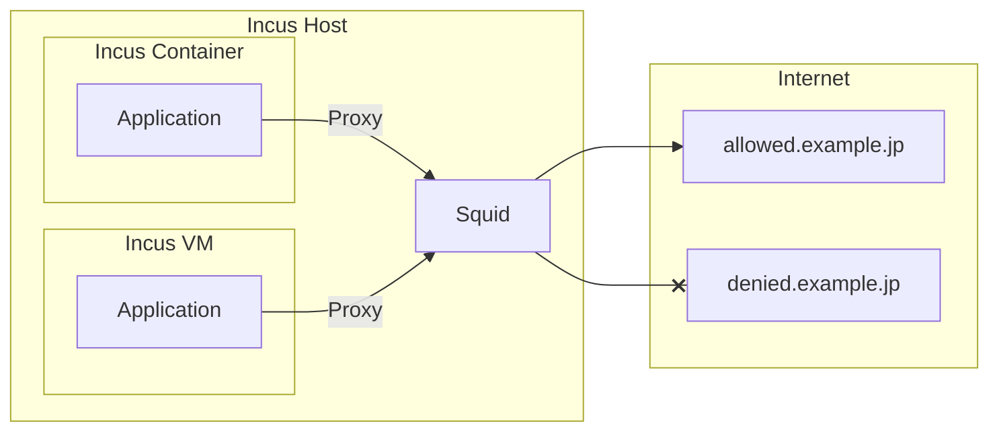

## はじめに

AIエージェントのsandboxを作るのに、使い慣れたIncusを活用したいと考えました。
Incusのインスタンスはファイルシステムは元々ホストと分離されているので、あとは外向き通信です。
ChatGPTに聞いて、Incusのホスト上でSquidを動かす構成を試してみたのでメモです。

## 構成図

Incusインスタンス（コンテナまたは仮想マシン）では`https_proxy`などの環境変数を設定し、Incusホスト上のSquidでフォワードプロキシーしてインターネット上のホストにアクセスします。この際SquidのACLで許可したドメインのみにアクセスできるようにします。



## SquidのインストールとACLの設定

SquidはUbuntuのパッケージでインストールします。

```
sudo apt-get install -y squid
```

ACLの設定ファイル `/etc/squid/conf.d/acl.conf` を以下の内容で作成します。
SquidのACLの詳細は https://wiki.squid-cache.org/SquidFaq/SquidAcl を参照してください。
```
acl SSL_ports port 443
acl Safe_ports port 80
acl Safe_ports port 443

http_access deny !Safe_ports
http_access deny CONNECT !SSL_ports

acl allowed_domains dstdomain "/etc/squid/allowed_domains.txt"

http_access allow allowed_domains
http_access deny all
```

上記で指定した`/etc/squid/allowed_domains.txt`ファイルにアクセスを許可するドメインのリストを記載します。`.github.com`のようにドットで始めるとそのドメインとサブドメインを許可します。サブドメインの例としてあげていますが、github.comの場合はセキュリティー上は個々のサブドメインを設定したほうが良いと思います。
```
# ubuntu
archive.ubuntu.com
security.ubuntu.com
motd.ubuntu.com
esm.ubuntu.com
contracts.canonical.com
livepatch.canonical.com

# github
.github.com
.githubusercontent.com

# node.js
nodejs.org
registry.npmjs.org

# mise
mise-versions.jdx.dev

# python
pypi.org
files.pythonhosted.org

# uv
astral.sh
releases.astral.sh

# trafficserver
ci.trafficserver.apache.org

# lan
192.0.2.3
```

## インスタンスでホストのSquidをフォワードプロキシーとして使う設定

`cloud-init`を使って、Incusのインスタンス（コンテナまたは仮想マシン）の作成時に`http_proxy`や`https_proxy`などの環境変数を設定し、http(s)通信にホストのSquidをフォワードプロキシーとして使うようにします。

以下のコマンドで`default`プロファイルの設定を編集します。
```
incus profile edit default
```

表示された内容のうち
```
config; {}
```
の部分を以下のように書き換えます。
`192.0.2.2`はIncusホストのIPアドレスに置き換えてください。3128はSquidのデフォルトポートです。
```
config:
  cloud-init.user-data: |
    #cloud-config
    timezone: Asia/Tokyo
    package_upgrade: true
    packages:
      - rsync
    bootcmd:
      - mkdir -p /etc/systemd/system.conf.d
      - sed -i 's|^#Defaults:%sudo env_keep += "http_proxy https_proxy ftp_proxy all_proxy no_proxy"|Defaults:%sudo env_keep += "http_proxy https_proxy HTTP_PROXY HTTPS_PORXY ftp_proxy all_proxy no_proxy NO_PROXY"|' /etc/sudoers
    write_files:
      - path: /etc/profile.d/90-http_proxy.sh
        permissions: "0644"
        content: |
          export http_proxy=http://192.0.2.2:3128
          export https_proxy=http://192.0.2.2:3128
          export HTTP_PROXY=http://192.0.2.2:3128
          export HTTPS_PROXY=http://192.0.2.2:3128
          export no_proxy=localhost,127.0.0.1
          export NO_PROXY=localhost,127.0.0.1
      - path: /etc/apt/apt.conf.d/90proxy
        permissions: "0644"
        content: |
          Acquire::http::Proxy "http://192.0.2.2:3128/";
          Acquire::https::Proxy "http://192.0.2.2:3128/";
      - path: /etc/systemd/system.conf.d/proxy.conf
        permissions: "0644"
        content: |
          [Manager]
          DefaultEnvironment="http_proxy=http://192.0.2.2:3128"
          DefaultEnvironment="https_proxy=http://192.0.2.2:3128"
    runcmd:
      - systemctl daemon-reexec
```

インスタンスの作成時に`cloud-init`対応のイメージを使用する必要があります。
以下の例のように、イメージ名が`/cloud`で終わるものを指定するようにします。

Ubuntu 26.04のコンテナをc1という名前で作成する例。
```
incus launch iamges:ubuntu/26.04/cloud c1
```

Ubuntu 26.04の仮想マシン（Virtual Machine）をvm1という名前で作成する例。
```
incus launch iamges:ubuntu/26.04/cloud --vm vm1
```

### `https_proxy`などの環境変数の名前の大文字小文字について
[We need to talk: Can we standardize NO_PROXY?](https://about.gitlab.com/blog/we-need-to-talk-no-proxy/)によると、小文字の`https_proxy`か大文字の`HTTPS_PROXY`のどちらを参照するかがいろいろなソフトウェアーによって違うそうです。ということで、大文字と小文字の両方の環境変数を設定しています。

### 環境変数の指定方法についての補足
`man environment.d`によると`/etc/environemnt.d/*.conf`で環境変数を指定することもできるようなのですが、不採用にしました。試してみたのですが`incus shell インスタンス名`でインスタンスに入ると設定が効いていなかったためです。

代わりに`/etc/profile.d/90-http_proxy.sh`を作成して環境変数を設定しています。

また、`sudo`を実行する際に環境変数が引き継がれるように`/etc/sudoers`を編集しています。通常なら`sudo visudo`で編集すべきですが、`cloud-init`で初期化する時点では他に編集している人はいないので`sed`で編集しています。

`/etc/apt/apt.conf.d/90proxy`は`apt`や`apt-get`でプロキシーを使うための設定です。

`/etc/systemd/system.conf.d/proxy.conf`はsystemdのサービスでプロキシーを使うための設定です。`bootcmd`で`/etc/systemd/system.conf.d/`ディレクトリーを作成し、`write_files`でファイルを作った後、`runcmd`で`systemctl daemon-reexec`を実行して反映しています。

## SquidのACLの許可対象のホストの追加手順

Squidで許可していないホストにアクセスしようとすると、403エラーになりSquidのアクセスログに`TCP_DENIED`のログが出ます。以下のコマンドでSquidのアクセスログを確認します。

```
sudo tail /var/log/squid/access.log
```

ログの例を示します。`198.51.100.1`はアクセス元のIPアドレスで`example.jp`がアクセスしようとしたドメインです。
```
1784483719.888     32 198.51.100.1 TCP_DENIED/403 3379 GET https://example.jp/ - HIER_NONE/- text/html
```

`/etc/squid/allowed_domains.txt`を編集して、許可するドメインを追加します。
```
sudo vim /etc/squid/allowed_domains.txt
```

Squidをリロードして変更を反映します。
```
sudo systemctl reload squid
```

## IncusのACLでインスタンスからはホストのSquidへの通信のみ許可

上記のプロファイルで`https_proxy`などの環境変数を設定していますが、インスタンス内で`https_proxy`などの環境変数を削除されるかもしれません。すると、プロキシーを通さずに外向きの通信ができてしまいます。これを防ぐため、IncusのネットワークでACLを設定し、インスタンスからはホストのSquidへの通信のみ許可します。

以下のコマンドでacl設定を作成します。設定名の`http-proxy-only`はお好みで変更してください。
```
incus network acl create http-proxy-only
```

以下のコマンドで、上記で作成したacl設定にルールを追加します。`192.0.2.2`はホストのIPアドレスに置き換えてください。
```
incus network acl rule add http-proxy-only egress \
  action=allow destination=192.0.2.2 protocol=tcp destination_port=3128
```

以下のコマンドで作成したacl設定の内容を確認できます。

```
incus network acl show http-proxy-only
```

出力される内容の例を以下に示します。
```
name: http-proxy-only
description: ""
egress:
  - action: allow
    destination: 192.0.2.2
    protocol: tcp
    destination_port: "3128"
    state: enabled
ingress: []
config: {}
used_by:
  - /1.0/networks/incusbr0
project: default
```

Incusの初期セットアップ時に作られるブリッジネットワークの`incusbr0`に上記で作成したACLを適用するには以下のよう実行します。
```
incus network set incusbr0 security.acls="http-proxy-only"
```

ネットワークに設定されているACLの名前は以下のように確認できます。
```
$ incus network get incusbr0 security.acls
http-proxy-only
```

IncusのACL設定の詳細は[ネットワーク ACL を設定するには - Incus ドキュメント](https://incus-ja.readthedocs.io/ja/latest/howto/network_acls/)を参照してください。

## (脱線) cloud-initの他の設定について

### タイムゾーンの設定
`timezone: Asia/Tokyo`でタイムゾーンを日本時間にしています。

### ホストとインスタンス間でrsyncを使うための設定

`incus file push`や`incus file pull`でも`--recursive`オプションを使えばでホストとインスタンス間で指定のディレクトリー以下を再帰的にコピーできます。が、変更されたファイルだけをコピーしたいなどrsyncを使いたいケースもあります。

rsyncを使うにはコピー元とコピー先の両方にrsyncパッケージをインストールする必要があります。
そのため、以下の設定でパッケージをアップグレードしてrsyncをインストールしています。
```
    package_upgrade: true
    packages:
      - rsync
```

ホスト側では以下のエイリアスを定義します。

```
alias incusrsync='rsync -e fake-ssh'
```

`fake-ssh`は以下の内容で作成し、実行パーミションをつけて`$HOME/.local/bin`などPATHの通った場所に置きます。

```
#!/bin/sh
set -eu

ctn="${1}"
shift

exec incus exec --project ${PROJECT:-default} "${ctn}" -- "$@"
```

これで以下のように実行するとホストからインスタンスにrsyncでディレクトリーを再帰的にコピーします。コピー元のディレクトリーの最後のスラッシュの有無での挙動はrsyncと同じで、以下のコマンドでは`/path/to/dest/foo`ディレクトリーが作られることになります。
```
incusrsync -av /path/to/src/foo instance_name:/path/to/dest/
```
この後、`/path/to/src/foo`配下の一部のファイルを変更してそれをインスタンスにコピーしたい場合は以下のように実行します。
```
incusrsync -av /path/to/src/foo/ instance_name:/path/to/dest/foo/
```
